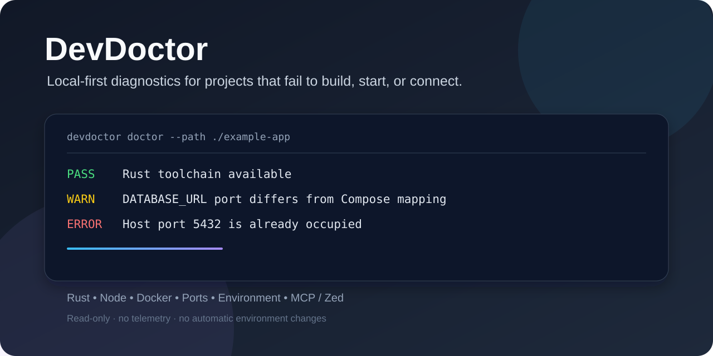
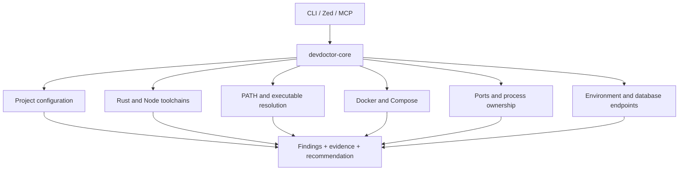

# DevDoctor

[](https://github.com/Bannawat01/DevDoctor/actions/workflows/ci.yml)
[](https://registry.modelcontextprotocol.io/v0.1/servers/io.github.Bannawat01%2Fdevdoctor/versions/latest)
[](https://crates.io/crates/devdoctor-mcp)
[](LICENSE-MIT)

**Local, read-only diagnostics for projects that fail to build, start, or connect.**



DevDoctor correlates project configuration, toolchains, PATH resolution, Docker,
ports, environment variables, and database endpoints into evidence-backed
findings. It tells you what was observed, how confident the diagnosis is, and
what to check next.

> No telemetry. No cloud calls. No automatic installs. No environment changes.

## Why DevDoctor?

Most environment checks stop at “is the executable installed?”. DevDoctor looks
for conflicts across the whole local project:

- A Windows Rust build can resolve the wrong `link.exe` before the MSVC linker.
- A Compose service can publish a host port already occupied by another process.
- `DATABASE_URL` can point at a port different from the Compose mapping.
- A Node project can declare an incompatible engine or conflicting lockfiles.

Findings are deterministic, traceable, and classified as confirmed or suspected.

## See the diagnostic flow



The CLI and MCP server share the same diagnostic engine. MCP is local stdio and
read-only; it never executes repository scripts or changes project state.

## Quick start

### CLI

For a normal installation, install the published CLI:

```bash
cargo install devdoctor-cli --version 0.1.2 --locked
devdoctor doctor --path .
```

To run from the repository or build workspace release binaries instead:

```bash
cargo run -p devdoctor-cli -- doctor --path .
cargo run -p devdoctor-cli -- doctor --json
cargo run -p devdoctor-cli -- check rust
cargo run -p devdoctor-cli -- check docker
cargo run -p devdoctor-cli -- check ports
cargo run -p devdoctor-cli -- check env
cargo run -p devdoctor-cli -- explain RUST-LINKER-001
```

Exit codes are stable: `0` means healthy, `1` means diagnostic findings were
reported, and `2` means invalid invocation or inspection failure.

### MCP and Zed

Install the published local server:

```powershell
cargo install devdoctor-mcp --version 0.1.2 --locked
```

In Zed, open **Settings > AI > MCP Servers > Add Local Server** and use:

```json
{
  "context_servers": {
    "devdoctor": {
      "command": "devdoctor-mcp",
      "args": []
    }
  }
}
```

If Zed does not inherit Cargo's binary directory, use
`%USERPROFILE%/.cargo/bin/devdoctor-mcp.exe`. A portable copy of the same
configuration is in [`docs/zed-mcp.json`](docs/zed-mcp.json).

The MCP server exposes exactly five tools:

| Tool | Purpose |
|---|---|
| `diagnose_project` | Run the aggregate project diagnosis |
| `check_toolchain` | Inspect Rust and Node toolchains |
| `check_environment` | Inspect declared environment configuration |
| `check_ports` | Inspect configured local project ports |
| `explain_finding` | Explain a stable diagnostic code |

The official Registry entry is `io.github.Bannawat01/devdoctor` and currently
publishes `devdoctor-mcp 0.1.2` from crates.io.

## Example finding

Human-readable output is concise and actionable:

```text
DevDoctor

Project: Example App
Stack: Rust + Docker + PostgreSQL

Rust:
PASS  Cargo available
WARN  Suspicious Windows linker resolution

Ports:
ERROR Host port 5432 is occupied

Environment:
WARN  DATABASE_URL port differs from Compose mapping

Recommended actions:
1. Review the effective linker search order.
2. Resolve the local PostgreSQL port conflict.
3. Align DATABASE_URL with the published host port.
```

JSON mode preserves the same stable finding codes and redacts values that may
contain credentials.

## Supported diagnostics

| Area | What DevDoctor checks |
|---|---|
| Project detection | Cargo, Rust toolchains, Node manifests/lockfiles, Compose, env files |
| Rust | Compiler/Cargo availability, targets, MSVC/GNU mismatch, linker evidence |
| Node | Node version, package manager, engines, lockfile consistency, dependencies |
| PATH | Effective search order, executable shadowing, Windows linker conflicts |
| Docker | CLI/engine reachability, Compose services, unhealthy/exited states, mapped ports |
| Ports | Relevant TCP conflicts and process ownership where the OS permits it |
| Environment | Missing variables, placeholders, host/port inconsistencies, redaction |
| PostgreSQL | Read-only endpoint reachability and Compose/DATABASE_URL mismatches |

## Platform support and limits

| Platform | Status |
|---|---|
| Windows 10/11 x86_64 | Supported MVP platform |
| Linux x86_64 | Experimental CI coverage |
| macOS | Not implemented as a supported target |

Port ownership is currently IPv4-only: Windows uses `GetExtendedTcpTable(AF_INET)`
and Linux reads `/proc/net/tcp`. An occupied IPv6 listener may therefore have no
owner evidence. Full executable paths are never included in CLI or MCP findings;
only `executable_path_available` is exposed.

The minimal Zed extension wrapper is optional compatibility packaging. The MCP
Registry and local stdio server are the primary integration path.

## Privacy and safety

- Read-only diagnostics; no process termination or environment mutation.
- No automatic dependency installation or repository script execution.
- No telemetry, hosted database, paid API, or cloud upload.
- Credentials and connection-string passwords are redacted.
- Subprocess calls are bounded and output-size limited.
- Network inspection is limited to project-relevant local endpoints.

## Release and contribution links

- [MCP Registry metadata and Zed setup](docs/zed-mcp-registry.md)
- [Windows releases](https://github.com/Bannawat01/DevDoctor/releases)
- [Contributing guide](CONTRIBUTING.md)
- [Security policy](SECURITY.md)
- [Issue tracker](https://github.com/Bannawat01/DevDoctor/issues)

DevDoctor is licensed under [MIT](LICENSE-MIT) or [Apache-2.0](LICENSE-APACHE),
at your option.
